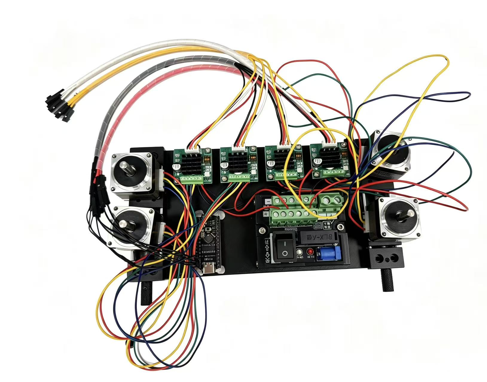

# 推进器装配与接线

本文记录 ATmega168 Nano 与四块外置步进驱动板的装配。ESP32-S3 集成 PCB 的接线以 [PCB 协议与引脚](../control%20code/pcb_esp32s3/docs/协议与引脚.md) 为准。

## Nano 外置驱动板方案的设备组成

| 设备 | 数量 | 作用 |
|---|---:|---|
| 28HS28 步进电机 | 4 | 驱动四个推进滑轮，额定电流 0.8 A |
| GEC-D3030 滚筒 | 4 | 上二下二夹持导管 |
| 步进电机驱动板 | 4 | 分别驱动四个步进电机；四路均设为 0.5 A、1/64 细分 |
| ATmega168 + CH340C Nano 兼容板 | 1 | 接收上位机串口命令，产生脉冲和方向信号 |
| 24 V / 8.3 A 电源适配器 | 1 | 为步进驱动系统供电 |
| DH-6SWL 端子台 | 1 | 分配电源和连接线路 |
| DK25-20 导轨 | 2 | 安装固定电气部件 |
| 一母分二公杜邦线 | 2 | 分配上下两组方向信号 |
| 一母分四公杜邦线 | 3 | 分配公共脉冲和方向参考信号 |
| GameSir T4n Lite 手柄 | 1 | 提供推进、回退和急停输入 |

## 连接与结构

### 机械结构

四个电机按上二下二排列，每个电机连接一个滑轮。上下两组滑轮共同夹持导管：前进或回退时，上下两组电机的旋转方向相反，但四个电机的脉冲频率相同。

### 电机与驱动板

每个电机连接一块驱动板，电机线序为：

| 电机线颜色 | 驱动板端子 |
|---|---|
| 红色 | `A+` |
| 绿色 | `A-` |
| 黄色 | `B+` |
| 蓝色 | `B-` |

四块驱动板分别连接 24 V 电源和各自的电机；控制输入由同一块 ATmega168 开发板分配。当前四块驱动板的限流均设置为 **0.5 A**，拨码细分均设置为 **1/64**，四路设置保持一致。

### Arduino 与四块驱动板

| Arduino 引脚 | 分线和驱动板连接 | 功能 |
|---|---|---|
| D8 | 一母分四公 → 四块驱动板 `P-` | 脉冲参考端，固定 LOW |
| D9 | 一母分四公 → 四块驱动板 `P+` | 公共脉冲，控制四个电机的共同速度 |
| D10 | 一母分四公 → 四块驱动板 `D-` | 方向参考端，固定 LOW |
| D11 | 一母分二公 → 下面两块驱动板 `D+` | 下组方向 |
| D12 | 一母分二公 → 上面两块驱动板 `D+` | 上组方向 |

当前固件的方向电平为：

| 导管命令 | D12 上组 `D+` | D11 下组 `D+` | D9 公共 `P+` |
|---|---|---|---|
| 正速（定义为前进） | HIGH | LOW | 按速度输出脉冲 |
| 负速（定义为回退） | LOW | HIGH | 按速度输出脉冲 |
| 停止 | 保持 | 保持 | LOW，与 D8 同电平 |

手动点动已经确认四个电机能够同时转动，上下两组旋转方向相反；滑轮安装后的实际“正速是否对应导管前进”仍需结合整机确认。

## 电源与停止

Nano 固件没有通信超时停车，需保留独立停机手段。`V0` 只停止脉冲，不切断保持电流；测试结束需关闭 24 V。外置驱动板此前出现过过热保护，测试应观察温升和散热，并从低速短时开始。
